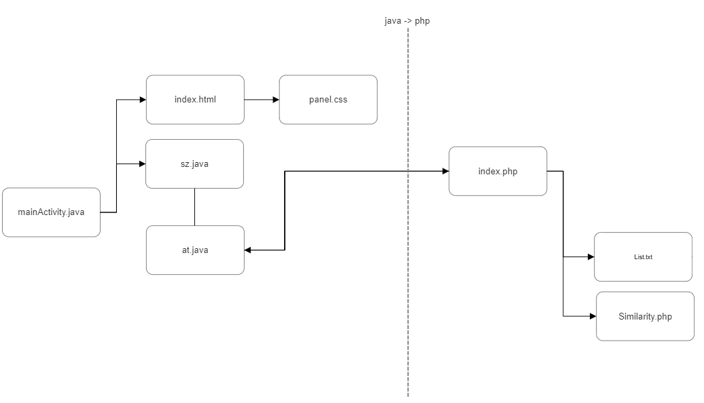

<p align="center"></p>

# Gedir

**<p align="center">We are currently developing the core.</p>**
**<p align="center">Ideas, feedback, and contributions to code are all very welcome.</p>**

</br>

An AI companion who is eager to learn and would love to see the world through your eyes. Gedir is always ready to chat when you need an empathetic friend

</br>


<p align="center">


</p>

---

### Software map



**core:**

```
[1] index.php
[2] list.txt
[3] Similarity.php
```

**application (Gedir):**

```
[1] index.html
[2] sz.java
[3] at.java
[4] MainActivity.java
[5] panel.css
```

---

### License

Gedir is licensed under the [MIT license](https://github.com/sobazino/AI_Gedir/blob/main/LICENSE).
